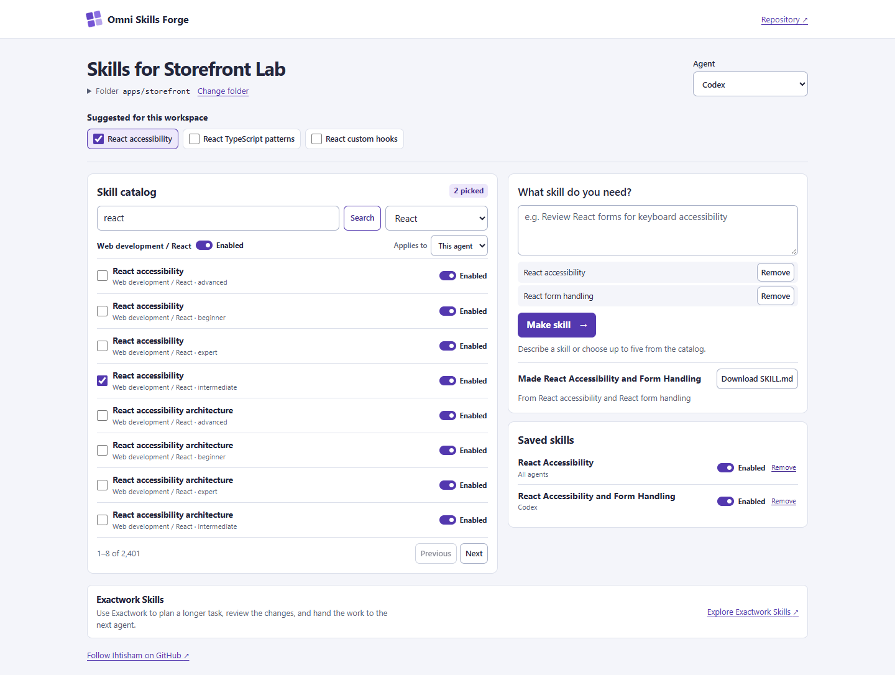

# Omni Skills Forge

Find a useful skill without browsing all **50,009 files**. Open Omni in your project and it suggests a few skills for the work in that folder. You decide which skills your agent can use.

[](https://www.npmjs.com/package/omni-skills-forge) · [GitHub repository](https://github.com/theihtishaam/omni-skills-forge)

## Open it in your project

With Node.js 18 or later, run these commands from your project folder.

```sh
npm install -g omni-skills-forge@latest
osf dashboard
```

1. **Find a skill.** Start with the workspace suggestions, or search the catalog and choose a category. There are 28 categories across six families.
2. **Choose what to use.** Switch individual skills or a whole category on or off. The project setting applies to everyone working there. Choose an agent for a personal override. A disabled project category stays off for every agent.
3. **Make one skill.** Check the skills you want to merge, or type what you need and let Omni pick relevant sources. Click **Make skill**. The saved result belongs to this workspace.


## Ask your agent

> Make one skill for reviewing keyboard accessibility and form submission in this React checkout.

A connected agent can make the skill directly through Omni’s MCP tool. You can also type the same sentence in the dashboard. Omni combines eligible catalog guidance, shows which files it used, and lets you switch the saved skill off. If nothing matches, it asks for a more specific request. [Connect your agent](https://github.com/theihtishaam/omni-skills-forge/blob/v2.3.1/docs/TASK_SKILLS.md)



Prefer the terminal? Run `osf make "Review keyboard accessibility and form submission in React"` from the project. [Browse all categories](https://github.com/theihtishaam/omni-skills-forge/blob/v2.3.1/docs/CATEGORIES.md) · [See the measured workspace example](https://github.com/theihtishaam/omni-skills-forge/blob/v2.3.1/docs/workspace-comparison.json)

**Exactwork Skills** helps with longer jobs that need a plan, a review, and a handoff to the next session. [Explore Exactwork Skills](https://github.com/theihtishaam/exactwork-skills)

**Ihtisham Ahmad** builds Omni Skills Forge and Agent Shadow Brain. [Follow Ihtisham on GitHub](https://github.com/theihtishaam)
