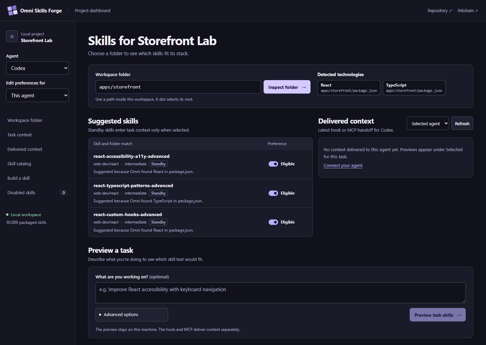
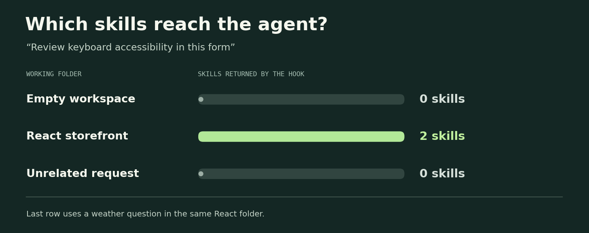
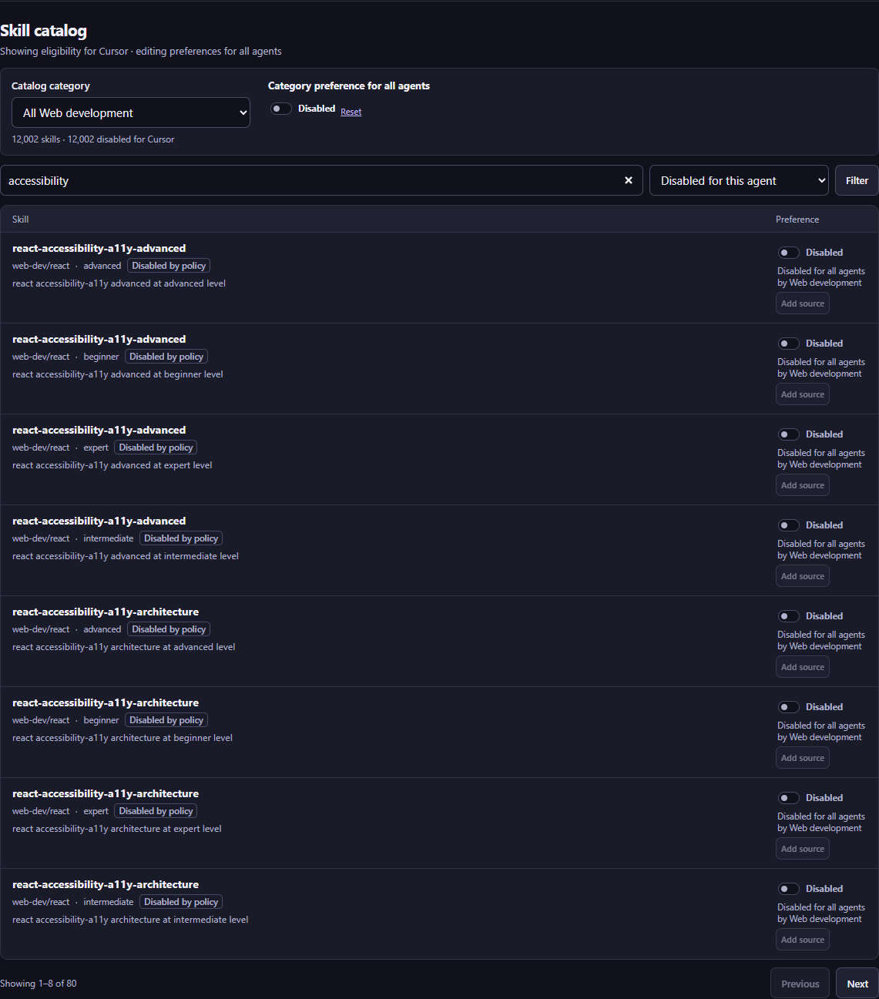
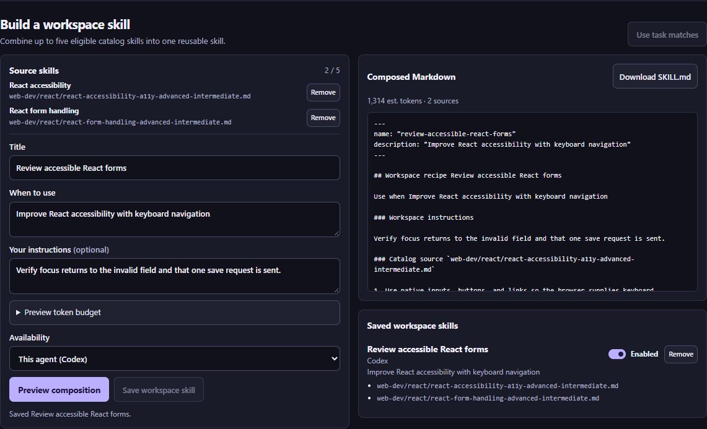
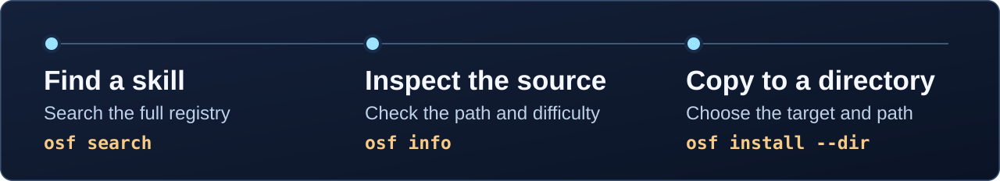

# Omni Skills Forge

Your agent can pick up the skills it needs from the folder where you are working. Omni matches a request against **50,009 local Markdown files**, picks up to three by default, and shows what each connected agent received. Give each project its own rules.

[](https://github.com/theihtishaam/omni-skills-forge)
[](https://github.com/theihtishaam)

[Browse the source and star Omni Skills Forge](https://github.com/theihtishaam/omni-skills-forge) · [Follow creator Ihtisham Ahmad on GitHub](https://github.com/theihtishaam)

[](https://www.npmjs.com/package/omni-skills-forge)
[](https://www.npmjs.com/package/omni-skills-forge)
[](LICENSE)

[Quick start](#quick-start) · [Automatic selection](#automatic-selection) · [Catalog](#catalog) · [CLI reference](#cli-reference)


## Quick start

In your project folder, run these commands with Node.js 18 or later.

```sh
npm install -g omni-skills-forge@latest
osf dashboard --serve
```

The dashboard opens in your browser. It also prints a local address you can reopen while the command runs.

### 1. Inspect the folder where the work happens

Choose an **Agent** on the left. The dashboard starts at your project root. In a repository with several apps, enter a relative folder such as `apps/storefront` and click **Inspect folder**. Under **Detected technologies**, you can see the filename behind each match. **Suggested skills** are on standby. Inspecting a folder sends no skill text to an agent.



### 2. Try a task in your own words

Open **Preview a task**, enter “Review keyboard accessibility in this form,” and click **Preview task skills**. **Selected for this task** lists the files and the reason each matched. Download the Markdown to read exactly what your agent would receive. A preview stays in the dashboard.


In a controlled example, we submitted that exact sentence to the Codex prompt hook from two different folders. The empty folder produced no guidance. The React storefront selected accessibility and form-handling guidance. Asking about the weather in that same storefront returned zero skill text.



Reproduce the comparison from the repository with `node scripts/measure-workspace.mjs`. The output includes each chosen catalog path and the byte count returned by the hook. [Measurement script](https://github.com/theihtishaam/omni-skills-forge/blob/v2.3.0/scripts/measure-workspace.mjs) · [Recorded output](https://github.com/theihtishaam/omni-skills-forge/blob/v2.3.0/docs/workspace-comparison.json)

### 3. Set the rules for each agent

Under **Skill catalog**, choose **This agent** or **All agents** before changing a switch. Use the category dropdown to browse a family or a single topic. For example, pick **Docker** and turn it off for Codex to skip Docker guidance in this project. The other DevOps categories and Claude Code keep their own settings. Selecting a category in the dropdown only filters the list. Its switch changes what agents can receive.

For a smaller change, leave the category eligible and turn off just one skill. A project-wide exclusion applies to every agent. If a whole family is disabled, turn that family back on before enabling one of its categories.



| What the dashboard shows | What happens on the next request |
| --- | --- |
| Eligible or enabled | The skill can be selected when it fits the task. The default limit is three. |
| Standby | The folder suggests this skill. Its text stays out of the prompt until selected. |
| Disabled | Omni skips that file for the selected agent or the whole project. |
| Delivered context | Omni returned the listed files to an agent through its hook or MCP connection. |


### 4. Make a reusable skill from your selection

Suppose your team reviews checkout forms every week. Pick the accessibility and form-handling skills from the catalog, or start with the matches from a task preview. In the skill builder, name the combination **Checkout form review**, describe when to use it, and add a project rule such as “Check that a failed submission keeps the customer’s input.”

Preview the merged Markdown before saving. You can combine one to five catalog files, see their source paths, and save the result for this project or one agent. Future matching tasks can receive it as a single skill. If you turn off a source file or its category, Omni skips the saved combination. Under **Saved workspace skills**, you can disable it for later or remove your copy.



In the [recorded checkout example](https://github.com/theihtishaam/omni-skills-forge/blob/v2.3.0/docs/workspace-comparison.json), the Codex hook returned two source files as one workspace skill. Claude Code received none of the custom checkout instructions. Disabling the React category for Codex also stopped those instructions on its next request.

To reuse the instructions outside Omni, use **Download SKILL.md** on the preview. The download is a snapshot. Changes to this workspace’s rules apply to future Omni deliveries.

### Automatic selection

**Codex and Claude Code** can run Omni when you submit a prompt. Set up the project hook once and the host supplies its working folder for each request. **Other hosts with local MCP support** can call `select_skills` with the task and an optional project-relative directory. Choose one route per agent. [Copy the setup for your host](https://github.com/theihtishaam/omni-skills-forge/blob/v2.3.0/docs/TASK_SKILLS.md)

After submitting a matching task, open **Delivered context**. Choose **All agents** to see the latest handoff to each agent, or inspect an individual agent for its recent deliveries. Each entry shows the time, folder, method and exact files Omni returned. Your host controls what the model does with that guidance. You can also preview a request from the command line.

```sh
osf select "Review keyboard accessibility in this form" --agent codex --project . --directory apps/storefront
```

### Copy a skill by hand

You can still inspect and copy an individual file without connecting an agent.



```bash
osf search react-accessibility --limit 8
osf info react-accessibility-a11y-best-practices
osf install --skill react-accessibility-a11y-best-practices --tool cursor --dir ./sample-directory --dry-run
osf install --skill react-accessibility-a11y-best-practices --tool cursor --dir ./sample-directory
```

`--dir` sets the output root. The installer preserves each file’s relative category path and uses the selected target’s extension. The Cursor example writes an `.mdc` file under `./sample-directory/web-dev/react`. Install previews skip file writes and can create directories. The existing installer rewrites matching destination files, so use a new output directory while reviewing.

The registry contains several difficulty variants with the same name. `info` and `install --skill` choose the first exact name match, then fall back to a substring. Check the path and difficulty with `info` before copying. For exact file selection, open the [category directory](docs/CATEGORIES.md) and copy the specific source file.

## Catalog


| Family | Category paths | Skill files |
| --- | ---: | ---: |
| [Backend](docs/CATEGORIES.md#backend) | 6 | 12,962 |
| [Web development](docs/CATEGORIES.md#web-development) | 7 | 12,002 |
| [AI and ML](docs/CATEGORIES.md#ai-and-ml) | 5 | 8,642 |
| [DevOps](docs/CATEGORIES.md#devops) | 5 | 8,241 |
| [Cloud](docs/CATEGORIES.md#cloud) | 3 | 5,681 |
| [Database](docs/CATEGORIES.md#database) | 2 | 2,481 |
| **Total** | **28** | **50,009** |

The count covers shipped files, including difficulty variants. It corresponds to **12,506 distinct registry names**. The difficulty totals are 12,500 beginner, 12,500 intermediate, 12,500 advanced, and 12,509 expert. Browse [every category path with its file count](docs/CATEGORIES.md).

```bash
osf categories
osf list --category ai-ml/rag --difficulty advanced
osf list --category web-dev/react --json
```

## Installer targets

These are the file destinations built into the installer. The CLI copies file contents unchanged. Check your client version’s rule or skill format and confirm the client loads a selected file before installing in bulk.

| Target | `--tool` | Default destination | Extension |
| --- | --- | --- | --- |
| Claude Code | `claude-code` | `~/.claude/skills` | `.md` |
| Kilo | `kilo` | `~/.kilo/skills` | `.md` |
| Cline | `cline` | `~/.cline/skills` | `.md` |
| OpenCode | `opencode` | `~/.opencode/skills` | `.md` |
| Cursor | `cursor` | `./.cursor/rules` | `.mdc` |
| Windsurf | `windsurf` | `./.windsurf/rules` | `.md` |

Use an explicit `--tool` and `--dir` to control where files go. `--all` selects the entire catalog. `--tool all-tools` selects the installer’s detected targets, which are inferred from directory presence and can include its default Claude Code target. Directory presence does not verify a working installation or native activation.

## CLI reference

| Command | What it does |
| --- | --- |
| `osf dashboard --serve --project .` | Open the interactive project dashboard and manage skill choices by agent. |
| `osf select "task" --agent codex --project .` | Preview the selected context. Add `--output ./task-skills.md` to save a new Markdown file. |
| `osf disable <catalog-path> --agent claude-code --project .` | Exclude this file from Claude Code's selections in this project. Omit `--agent` to exclude it across agents. |
| `osf enable <catalog-path> --agent claude-code --project .` | Allow this file to compete when it matches, subject to the project's policy. |
| `osf disable --category devops/docker --agent codex --project .` | Skip Docker skills for Codex in this project. Use `--category devops` for the whole family. |
| `osf mcp --project . --agent codex` | Serve the task selection tool over standard input/output and keep a local receipt for delivered skills. |
| `osf` | Opens the interactive menu. |
| `osf search <query> --limit 25` | Matches names, descriptions, or tags across the full registry. |
| `osf info <name>` | Shows the selected registry entry, including the file path. |
| `osf list` | Lists up to 80 matching records by default. Use `--category`, `--tag`, `--difficulty`, or `--json`. |
| `osf categories` | Lists the six top-level families. |
| `osf stats` | Shows catalog, family, and difficulty counts. |
| `osf install --skill <name> --tool cursor --dir ./sample-directory` | Copies the selected file under an explicit output root. Use `--category`, `--tag`, `--difficulty`, or `--all` for a larger selection. |
| `osf dashboard --no-open --output ./osf-dashboard.html` | Generates a local HTML catalog with a preview of each family, tags, and difficulty breakdown. |
| `osf doctor` | Reports the local runtime and known client-directory checks. |
| `osf export --format json --output ./osf-registry.json` | Exports the full registry. CSV and Markdown (`md`) are also available. The Markdown output summarizes each family and includes up to 20 entries per family. |
| `osf update` | Prints the current package version and the npm update command. |

The exported HTML dashboard filters the sample cards embedded in that file. Use the interactive dashboard to search the catalog, change agent preferences and preview the actual context for a task.

The `uninstall` command scans the default client directories and removes matching Markdown or rule files, including files from other sources. Use `osf uninstall --tool cursor --dry-run` to inspect the scope. For a custom `--dir` install, manage that output folder directly.

## For work that spans several sessions

**Exactwork** is a companion for jobs where it matters how the agent carries out the work. For example, a database migration needs a record of the accepted plan, checks on the changed paths and a usable handoff for the next session. Start with its core skill, then add research, review or handoff when the task calls for it. The dashboard links to the install guide. [Explore Exactwork Skills](https://github.com/theihtishaam/exactwork-skills)

[Agent Shadow Brain](https://github.com/theihtishaam/agents-brain) gives coding agents shared project memory for decisions, context, and session handoffs.

## Source and license

This repository starts from the published `omni-skills-forge@2.1.1` npm archive. It preserves the shipped catalog, installer, and registry builder. [Archive integrity and restoration details](docs/PROVENANCE.md) · [MIT license](LICENSE)
