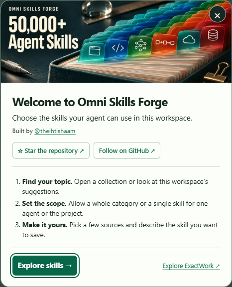
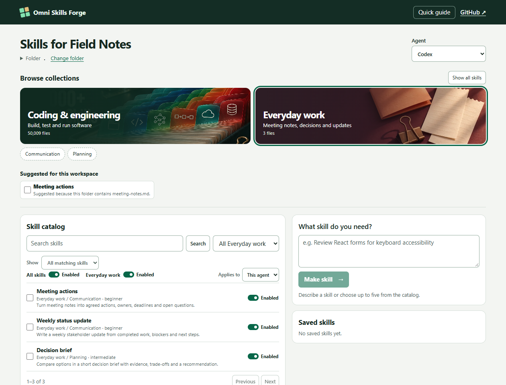
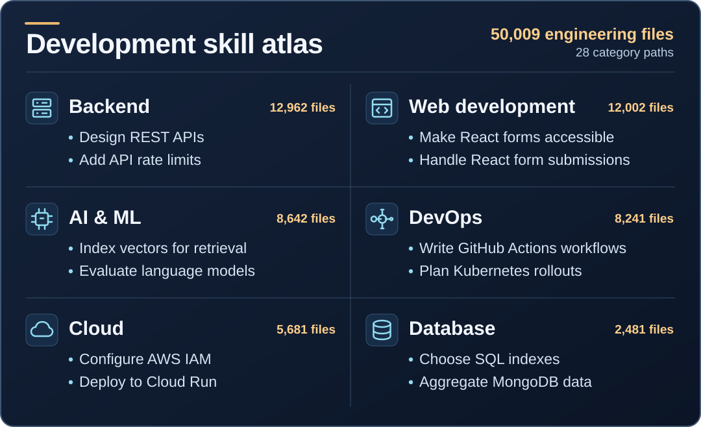
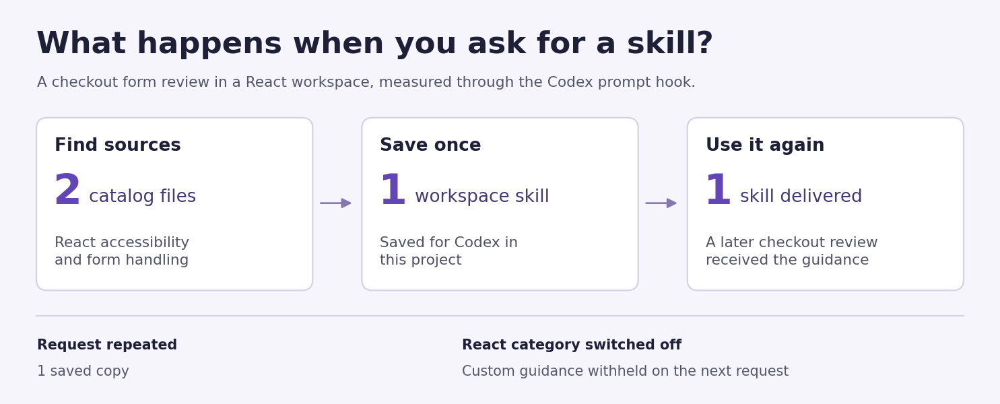

# Omni Skills Forge · 50,000+ skills for coding and project work

Find guidance for the task in front of you, then give your agent a few relevant skills. Omni has **50,012 Markdown skill files** across **30 category paths in seven families**. The file count includes difficulty variants, with **12,509 distinct skill names**.

[](https://www.npmjs.com/package/omni-skills-forge) · [Star Omni Skills Forge on GitHub](https://github.com/theihtishaam/omni-skills-forge) · [Follow Ihtisham Ahmad](https://github.com/theihtishaam)


[Quick start](#open-it-in-your-project) · [Work examples](#what-you-can-use-it-for) · [All 30 categories](#catalog-counts) · [Connect your agent](#ask-your-agent-to-make-a-skill) · [Install a native skill](#install-a-saved-skill-natively)

## Open it in your project

With Node.js 18 or later, run these commands from your project folder.

```sh
npm install -g omni-skills-forge@latest
osf dashboard
```

On first open, the local dashboard offers a quick guide. Choose **Explore skills** to continue. **Quick guide** in the header reopens it later. The GitHub links are optional and open only when clicked.



1. **Find skills.** Choose **Coding & engineering** or **Everyday work**. Click a family, then a topic. Search within that collection, or use the enabled/disabled filter to review your preferences. **Show all skills** returns to both collections. For everyday work, a folder containing `meeting-notes.md`, `weekly-status.md`, or `decision-log.md` gets a corresponding suggestion. Omni checks the filenames only.
2. **Choose what your agent can use.** Pick an agent or the whole project. Switch all skills, a category, or one file on or off. To use just one file, turn **All skills** off and turn that file on in the same scope.
3. **Make one skill.** Check the files you want to combine or describe the task and let Omni pick sources. Click **Make skill** to save the result in this workspace.



In the sample React workspace, switching everything off left **0** eligible files. Enabling one file brought that to **1**. Enabling the React category made **2,401** files eligible, and enabling the whole catalog restored **50,012**. A connected agent receives the files that match its task within the context budget.

## What you can use it for

| Work | Example task | Catalog starting point |
| --- | --- | --- |
| Backend | Add pytest coverage for invalid API inputs and expected errors. | [Python testing with pytest](https://github.com/theihtishaam/omni-skills-forge/blob/v2.4.0/skills/backend/python/python-testing-pytest-advanced-intermediate.md) |
| Web development | Review form labels, keyboard focus, and submission feedback in a React checkout. | [React keyboard accessibility](https://github.com/theihtishaam/omni-skills-forge/blob/v2.4.0/skills/web-dev/react/react-accessibility-a11y-advanced-intermediate.md) · [React form handling](https://github.com/theihtishaam/omni-skills-forge/blob/v2.4.0/skills/web-dev/react/react-form-handling-advanced-intermediate.md) |
| AI and ML | Choose how to split documentation for retrieval in a support assistant. | [RAG chunking strategies](https://github.com/theihtishaam/omni-skills-forge/blob/v2.4.0/skills/ai-ml/rag/rag-chunking-strategies-advanced-intermediate.md) |
| DevOps | Separate build dependencies from the runtime image in a multi-stage Docker build. | [Docker multi-stage builds](https://github.com/theihtishaam/omni-skills-forge/blob/v2.4.0/skills/devops/docker/docker-multi-stage-builds-advanced-intermediate.md) |
| Cloud | Investigate cold starts and runtime overhead in an AWS Lambda function. | [AWS Lambda optimization](https://github.com/theihtishaam/omni-skills-forge/blob/v2.4.0/skills/cloud/aws/aws-lambda-optimization-advanced-intermediate.md) |
| Database | Review a slow PostgreSQL query and plan a performance check. | [PostgreSQL query performance](https://github.com/theihtishaam/omni-skills-forge/blob/v2.4.0/skills/database/sql/sql-postgresql-performance-advanced-intermediate.md) |
| Everyday work | Turn meeting notes into actions, summarize a week, or compare options in a decision brief. | [Meeting actions](https://github.com/theihtishaam/omni-skills-forge/blob/v2.4.0/skills/work/communication/meeting-actions.md) · [Decision brief](https://github.com/theihtishaam/omni-skills-forge/blob/v2.4.0/skills/work/planning/decision-brief.md) |

## Catalog counts



| Family | Category paths and file counts |
| --- | --- |
| **Backend** · 6 categories · **12,962 files** | `backend/csharp` 1,760 · `backend/go` 1,920 · `backend/java` 2,000 · `backend/nodejs` 2,800 · `backend/python` 2,401 · `backend/rust` 2,081 |
| **Web development** · 7 categories · **12,002 files** | `web-dev/angular` 1,600 · `web-dev/astro` 1,280 · `web-dev/nextjs` 2,001 · `web-dev/react` 2,401 · `web-dev/remix` 1,280 · `web-dev/svelte` 1,520 · `web-dev/vue` 1,920 |
| **AI and ML** · 5 categories · **8,642 files** | `ai-ml/agents` 1,601 · `ai-ml/computer-vision` 1,600 · `ai-ml/llm` 2,240 · `ai-ml/mlops` 1,600 · `ai-ml/rag` 1,601 |
| **DevOps** · 5 categories · **8,241 files** | `devops/cicd` 1,600 · `devops/docker` 1,600 · `devops/kubernetes` 1,921 · `devops/monitoring` 1,600 · `devops/terraform` 1,520 |
| **Cloud** · 3 categories · **5,681 files** | `cloud/aws` 2,561 · `cloud/azure` 1,520 · `cloud/gcp` 1,600 |
| **Database** · 2 categories · **2,481 files** | `database/nosql` 880 · `database/sql` 1,601 |
| **Everyday work** · 2 categories · **3 files** | `work/communication` 2 · `work/planning` 1 |
| **Total** · 30 categories · **50,012 files** | 12,502 beginner · 12,501 intermediate · 12,500 advanced · 12,509 expert |

Open the directory links for each category or check the source of the counts. [Category directory](https://github.com/theihtishaam/omni-skills-forge/blob/v2.4.0/docs/CATEGORIES.md) · [Source provenance](https://github.com/theihtishaam/omni-skills-forge/blob/v2.4.0/docs/PROVENANCE.md)

## Ask your agent to make a skill

> Make one skill for reviewing keyboard accessibility and form submission in this React checkout.

With the Omni prompt hook connected in Codex or Claude Code, start a message with **“Make one skill for …”** to save a skill in the workspace. A connected MCP agent can also make a skill on request. Use the same sentence in the dashboard or run `osf make "Review keyboard accessibility and form submission in React"` from the project folder. [Agent setup](https://github.com/theihtishaam/omni-skills-forge/blob/v2.4.0/docs/TASK_SKILLS.md)


In the recorded checkout example, Omni combined the React accessibility and form-handling files into one skill. Repeating the request reused it. A later matching checkout review received the combined instructions. Disabling the React category stopped delivery on the next request.



Workspace context also helps with ordinary requests. “Review keyboard accessibility in this form” returned two files in a React storefront and zero in an empty folder. A weather question in the storefront returned zero. [Recorded measurements](https://github.com/theihtishaam/omni-skills-forge/blob/v2.4.0/docs/workspace-comparison.json) · [Reproduce the example](https://github.com/theihtishaam/omni-skills-forge/blob/v2.4.0/scripts/measure-workspace.mjs)


## Install a saved skill natively

Open a saved skill in the dashboard and select **Download SKILL.md**. Use the `name` in the file's frontmatter as its folder name. In your project, put the file at the path for your agent.

| Agent | Project-local file |
| --- | --- |
| Codex | `.agents/skills/<name>/SKILL.md` |
| Claude Code | `.claude/skills/<name>/SKILL.md` |

Review the exported file and use your agent's skill controls for this copy. [Codex skills](https://learn.chatgpt.com/docs/build-skills#where-codex-loads-local-skills) · [Claude Code skills](https://code.claude.com/docs/en/skills)

**Exactwork Skills** helps plan, review, and hand off longer jobs. [Explore Exactwork Skills](https://github.com/theihtishaam/exactwork-skills)

**Ihtisham Ahmad** builds Omni Skills Forge and Agent Shadow Brain. [Follow Ihtisham on GitHub](https://github.com/theihtishaam)
