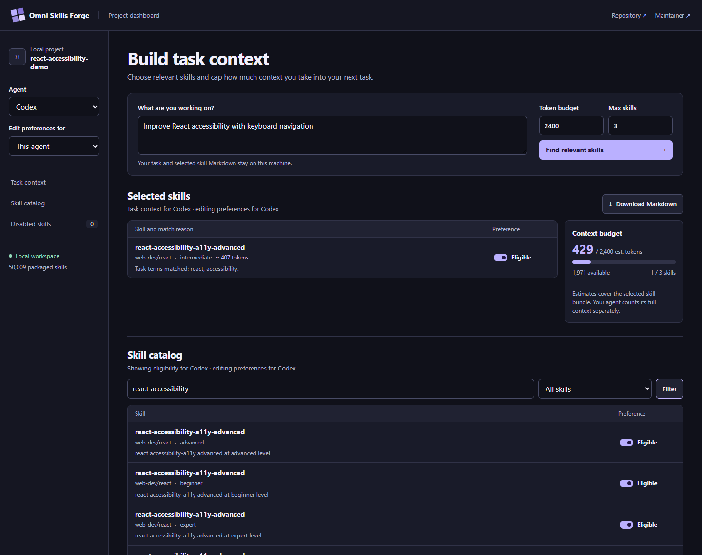
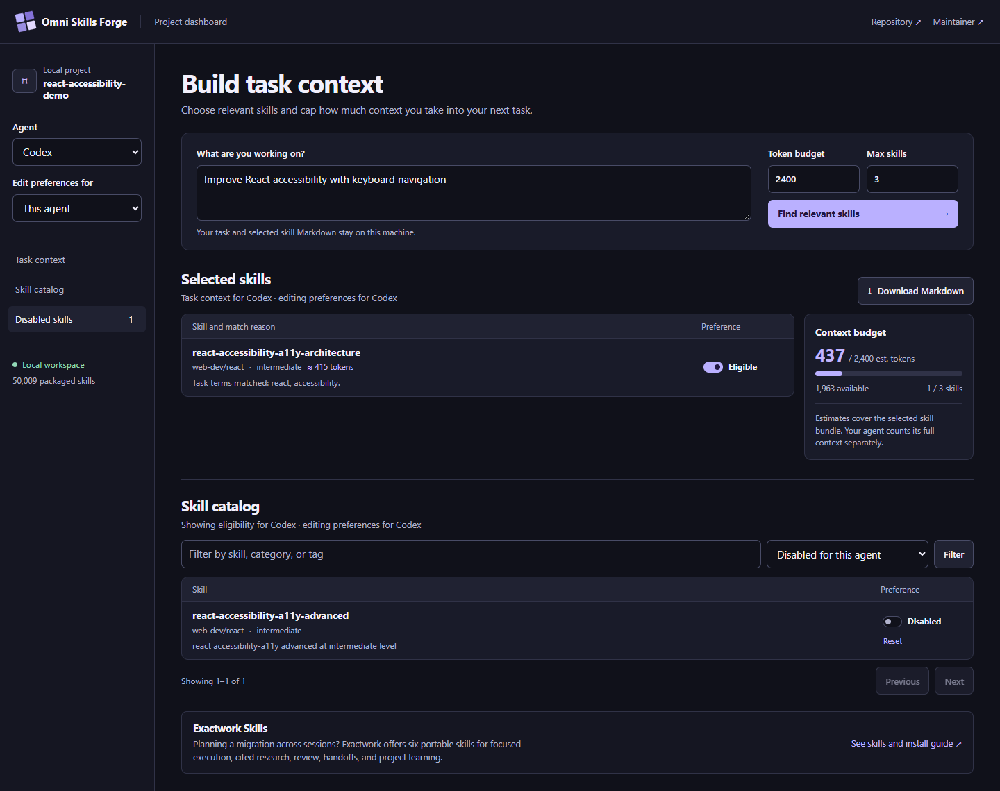

# Omni Skills Forge

Pick skills for the task in front of you. Omni searches **50,009 local Markdown skill files** and gives a connected agent a small selection within a budget you set. You can turn a skill off for one agent or for everyone working in a project.

[](https://github.com/theihtishaam/omni-skills-forge)
[](https://github.com/theihtishaam)

[Browse the source and star Omni Skills Forge](https://github.com/theihtishaam/omni-skills-forge) · [Follow creator Ihtisham Ahmad on GitHub](https://github.com/theihtishaam)

[](https://www.npmjs.com/package/omni-skills-forge)
[](https://www.npmjs.com/package/omni-skills-forge)
[](LICENSE)

[Quick start](#quick-start) · [Automatic selection](#automatic-selection) · [Catalog](#catalog) · [CLI reference](#cli-reference)


## Quick start

Use Node.js 18 or later. From your project directory:

```sh
npm install -g omni-skills-forge@latest
osf dashboard --serve --project .
```

Choose an agent, paste a task such as “Review React accessibility for keyboard navigation and focus in a form,” and build a preview. The dashboard shows the matching skills, why they qualified, and the estimated size of the text. Under **Skill catalog**, change eligibility for this agent or for the whole project. A project-wide exclusion applies to every agent.



To try the same selection from a terminal, run:

```sh
osf select "Review React accessibility for keyboard navigation and focus in a form" --agent codex --project . --max-skills 2 --token-budget 1400
```

With the default preferences in the 2.2.0 catalog, that example selects two files covering React accessibility and form handling. Their combined pack uses **823 estimated tokens** of the 1,400-token budget. The rest of the catalog contributes no skill text to the pack.

### Automatic selection

Codex and Claude Code can call Omni on each submitted prompt through a project hook. A matching prompt receives a skill pack. An unrelated prompt receives no skill text. Other compatible agents can request a pack using the read-only MCP tool `select_skills`. The host decides when to call it. Pick one method per host to avoid receiving the same guidance twice. [Host setup and examples](https://github.com/theihtishaam/omni-skills-forge/blob/v2.2.0/docs/TASK_SKILLS.md)

By default a pack has room for up to **3 skills** and **2,400 estimated tokens**. Eligible skills stay on standby until they match. Settings apply to packs produced by Omni. A skill previously installed as an always-on rule in another application follows that application's rules. The budget covers the selected text. A host can also spend tokens on its own instructions and tool descriptions.



### Copy a skill by hand

You can still inspect and copy an individual file without connecting an agent.


```bash
osf search react-accessibility --limit 8
osf info react-accessibility-a11y-best-practices
osf install --skill react-accessibility-a11y-best-practices --tool cursor --dir ./sample-directory --dry-run
osf install --skill react-accessibility-a11y-best-practices --tool cursor --dir ./sample-directory
```

`--dir` sets the output root. The installer preserves each file’s relative category path and uses the selected target’s extension. The Cursor example writes an `.mdc` file under `./sample-directory/web-dev/react`. Install previews skip file writes and can create directories. The existing installer rewrites matching destination files, so use a new output directory while reviewing.

The registry contains several difficulty variants with the same name. `info` and `install --skill` choose the first exact name match, then fall back to a substring. Check the path and difficulty with `info` before copying. For exact file selection, open the [category directory](docs/CATEGORIES.md) and copy the specific source file.

## Catalog


| Family | Category paths | Skill files |
| --- | ---: | ---: |
| [Backend](docs/CATEGORIES.md#backend) | 6 | 12,962 |
| [Web development](docs/CATEGORIES.md#web-development) | 7 | 12,002 |
| [AI and ML](docs/CATEGORIES.md#ai-and-ml) | 5 | 8,642 |
| [DevOps](docs/CATEGORIES.md#devops) | 5 | 8,241 |
| [Cloud](docs/CATEGORIES.md#cloud) | 3 | 5,681 |
| [Database](docs/CATEGORIES.md#database) | 2 | 2,481 |
| **Total** | **28** | **50,009** |

The count covers shipped files, including difficulty variants. It corresponds to **12,506 distinct registry names**. The difficulty totals are 12,500 beginner, 12,500 intermediate, 12,500 advanced, and 12,509 expert. Browse [every category path with its file count](docs/CATEGORIES.md).

```bash
osf categories
osf list --category ai-ml/rag --difficulty advanced
osf list --category web-dev/react --json
```

## Installer targets

These are the file destinations built into the installer. The CLI copies file contents unchanged. Check your client version’s rule or skill format and confirm the client loads a selected file before installing in bulk.

| Target | `--tool` | Default destination | Extension |
| --- | --- | --- | --- |
| Claude Code | `claude-code` | `~/.claude/skills` | `.md` |
| Kilo | `kilo` | `~/.kilo/skills` | `.md` |
| Cline | `cline` | `~/.cline/skills` | `.md` |
| OpenCode | `opencode` | `~/.opencode/skills` | `.md` |
| Cursor | `cursor` | `./.cursor/rules` | `.mdc` |
| Windsurf | `windsurf` | `./.windsurf/rules` | `.md` |

Use an explicit `--tool` and `--dir` to control where files go. `--all` selects the entire catalog. `--tool all-tools` selects the installer’s detected targets, which are inferred from directory presence and can include its default Claude Code target. Directory presence does not verify a working installation or native activation.

## CLI reference

| Command | What it does |
| --- | --- |
| `osf dashboard --serve --project .` | Open the interactive project dashboard and manage skill choices by agent. |
| `osf select "task" --agent codex --project .` | Preview the selected context. Add `--output ./task-skills.md` to save a new Markdown file. |
| `osf disable <catalog-path> --agent claude-code --project .` | Exclude this file from Claude Code's selections in this project. Omit `--agent` to exclude it across agents. |
| `osf enable <catalog-path> --agent claude-code --project .` | Allow this file to compete when it matches, subject to the project's policy. |
| `osf mcp --project . --agent codex` | Serve a single read-only task selection tool over standard input/output. |
| `osf` | Opens the interactive menu. |
| `osf search <query> --limit 25` | Matches names, descriptions, or tags across the full registry. |
| `osf info <name>` | Shows the selected registry entry, including the file path. |
| `osf list` | Lists up to 80 matching records by default. Use `--category`, `--tag`, `--difficulty`, or `--json`. |
| `osf categories` | Lists the six top-level families. |
| `osf stats` | Shows catalog, family, and difficulty counts. |
| `osf install --skill <name> --tool cursor --dir ./sample-directory` | Copies the selected file under an explicit output root. Use `--category`, `--tag`, `--difficulty`, or `--all` for a larger selection. |
| `osf dashboard --no-open --output ./osf-dashboard.html` | Generates a local HTML catalog with a preview of each family, tags, and difficulty breakdown. |
| `osf doctor` | Reports the local runtime and known client-directory checks. |
| `osf export --format json --output ./osf-registry.json` | Exports the full registry. CSV and Markdown (`md`) are also available. The Markdown output summarizes each family and includes up to 20 entries per family. |
| `osf update` | Prints the current package version and the npm update command. |

The exported HTML dashboard filters the sample cards embedded in that file. Use the interactive dashboard to search the catalog, change agent preferences and preview the actual context for a task.

The `uninstall` command scans the default client directories and removes matching Markdown or rule files, including files from other sources. Use `osf uninstall --tool cursor --dry-run` to inspect the scope. For a custom `--dir` install, manage that output folder directly.

## For work that spans several sessions

**Exactwork** is a companion for jobs where it matters how the agent carries out the work. For example, a database migration needs a record of the accepted plan, checks on the changed paths and a usable handoff for the next session. Start with its core skill, then add research, review or handoff when the task calls for it. The dashboard links to the install guide. [Explore Exactwork Skills](https://github.com/theihtishaam/exactwork-skills)

[Agent Shadow Brain](https://github.com/theihtishaam/agents-brain) gives coding agents shared project memory for decisions, context, and session handoffs.

## Source and license

This repository starts from the published `omni-skills-forge@2.1.1` npm archive. It preserves the shipped catalog, installer, and registry builder. [Archive integrity and restoration details](docs/PROVENANCE.md) · [MIT license](LICENSE)
