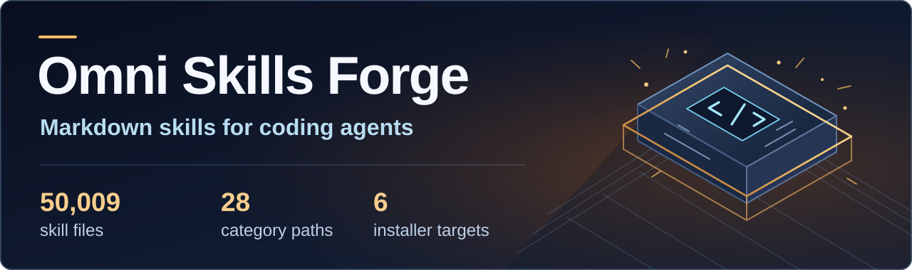
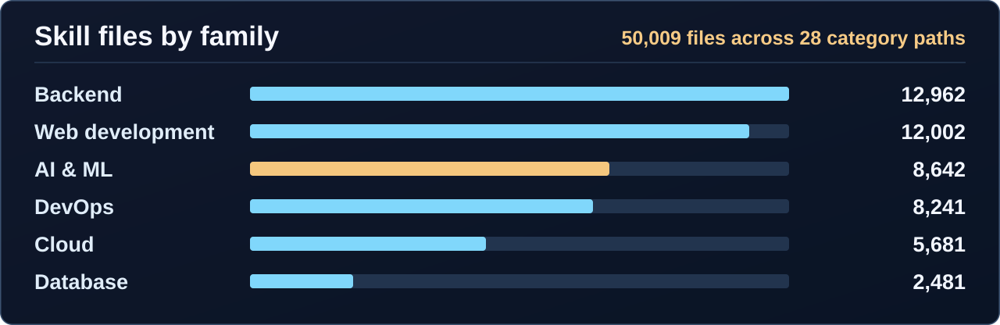

# Omni Skills Forge

[](https://github.com/theihtishaam)
[](https://www.npmjs.com/package/omni-skills-forge)
[](LICENSE)

Search a local catalog of Markdown instructions for coding agents, inspect the source, and copy the files you choose. The CLI filters by category, tag, or difficulty and offers six installer targets.

[Quick start](#quick-start) · [All 28 category paths](docs/CATEGORIES.md) · [Installer targets](#installer-targets) · [CLI reference](#cli-reference) · [Source provenance](docs/PROVENANCE.md)

<!-- NPM_TOTAL_START -->
**Total npm downloads: 140,381** · Through **2026-11-13**. [npm data](https://api.npmjs.org/downloads/point/2026-04-12:2026-11-13/omni-skills-forge).

GitHub refreshes this number daily. The npm README records the total when this version was published. Downloads include automated installs; they are not unique users.
<!-- NPM_TOTAL_END -->

## Quick start

Use Node.js 18 or later. Start with one skill and review the copied file before configuring your agent.


```bash
npm install -g omni-skills-forge
osf search kubernetes --limit 8
osf info kubernetes-admission-controllers-advanced
osf install --skill kubernetes-admission-controllers-advanced --tool cursor --dir ./sample-directory --dry-run
osf install --skill kubernetes-admission-controllers-advanced --tool cursor --dir ./sample-directory
```

`--dir` sets the output root. The installer preserves each file’s relative category path and uses the selected target’s extension. The Cursor example writes an `.mdc` file under `./sample-directory/devops/kubernetes`. Install previews skip file writes and can create directories. The existing installer rewrites matching destination files, so use a new output directory while reviewing.

The registry contains several difficulty variants with the same name. `info` and `install --skill` choose the first exact name match, then fall back to a substring. Check the path and difficulty with `info` before copying. For exact file selection, open the [category directory](docs/CATEGORIES.md) and copy the specific source file.

## Catalog



| Family | Category paths | Skill files |
| --- | ---: | ---: |
| [Backend](docs/CATEGORIES.md#backend) | 6 | 12,962 |
| [Web development](docs/CATEGORIES.md#web-development) | 7 | 12,002 |
| [AI and ML](docs/CATEGORIES.md#ai-and-ml) | 5 | 8,642 |
| [DevOps](docs/CATEGORIES.md#devops) | 5 | 8,241 |
| [Cloud](docs/CATEGORIES.md#cloud) | 3 | 5,681 |
| [Database](docs/CATEGORIES.md#database) | 2 | 2,481 |
| **Total** | **28** | **50,009** |

The count covers shipped files, including difficulty variants. It corresponds to **12,506 distinct registry names**. The difficulty totals are 12,500 beginner, 12,500 intermediate, 12,500 advanced, and 12,509 expert. Browse [every category path with its file count](docs/CATEGORIES.md).

```bash
osf categories
osf list --category ai-ml/rag --difficulty advanced
osf list --category web-dev/react --json
```

## Installer targets

These are the file destinations built into the installer. The CLI copies file contents unchanged. Check your client version’s rule or skill format and confirm the client loads a selected file before installing in bulk.

| Target | `--tool` | Default destination | Extension |
| --- | --- | --- | --- |
| Claude Code | `claude-code` | `~/.claude/skills` | `.md` |
| Kilo | `kilo` | `~/.kilo/skills` | `.md` |
| Cline | `cline` | `~/.cline/skills` | `.md` |
| OpenCode | `opencode` | `~/.opencode/skills` | `.md` |
| Cursor | `cursor` | `./.cursor/rules` | `.mdc` |
| Windsurf | `windsurf` | `./.windsurf/rules` | `.md` |

Use an explicit `--tool` and `--dir` to control where files go. `--all` selects the entire catalog. `--tool all-tools` selects the installer’s detected targets, which are inferred from directory presence and can include its default Claude Code target. Directory presence does not verify a working installation or native activation.

## CLI reference

| Command | What it does |
| --- | --- |
| `osf` | Opens the interactive menu. |
| `osf search <query> --limit 25` | Matches names, descriptions, or tags across the full registry. |
| `osf info <name>` | Shows the selected registry entry, including the file path. |
| `osf list` | Lists up to 80 matching records by default. Use `--category`, `--tag`, `--difficulty`, or `--json`. |
| `osf categories` | Lists the six top-level families. |
| `osf stats` | Shows catalog, family, and difficulty counts. |
| `osf install --skill <name> --tool cursor --dir ./sample-directory` | Copies the selected file under an explicit output root. Use `--category`, `--tag`, `--difficulty`, or `--all` for a larger selection. |
| `osf dashboard --no-open --output ./osf-dashboard.html` | Generates a local HTML catalog with a preview of each family, tags, and difficulty breakdown. |
| `osf doctor` | Reports the local runtime and known client-directory checks. |
| `osf export --format json --output ./osf-registry.json` | Exports the full registry. CSV and Markdown (`md`) are also available. The Markdown output summarizes each family and includes up to 20 entries per family. |
| `osf update` | Prints the current package version and the npm update command. |

The dashboard filters the sample cards embedded in its generated HTML. Use `osf search` or `osf list --json` to search or export the full catalog. Dashboard copy buttons copy a CLI command. Review its destination before running it.

The `uninstall` command scans the default client directories and removes matching Markdown or rule files, including files from other sources. Use `osf uninstall --tool cursor --dry-run` to inspect the scope. For a custom `--dir` install, manage that output folder directly.

## Source and license

This repository starts from the published `omni-skills-forge@2.1.1` npm archive. It preserves the shipped catalog, installer, and registry builder. [Archive integrity and restoration details](docs/PROVENANCE.md) · [MIT license](LICENSE)
