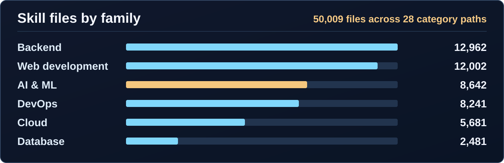

# Catalog categories

Omni Skills Forge includes **50,009 skill files in 28 category paths**. Each path below links to the shipped Markdown directory. Counts include difficulty variants and come from the [master registry](../registry/master-registry.json).

Use `osf categories` to list the six families. Pass a family or exact path to `osf list --category`. For example, `osf list --category ai-ml/rag --json` returns the full list of retrieval-augmented generation files.

## Backend

**12,962 files across six category paths.**

| Category | Skill files |
| --- | ---: |
| [`backend/csharp`](../skills/backend/csharp) | 1,760 |
| [`backend/go`](../skills/backend/go) | 1,920 |
| [`backend/java`](../skills/backend/java) | 2,000 |
| [`backend/nodejs`](../skills/backend/nodejs) | 2,800 |
| [`backend/python`](../skills/backend/python) | 2,401 |
| [`backend/rust`](../skills/backend/rust) | 2,081 |

## Web development

**12,002 files across seven category paths.**

| Category | Skill files |
| --- | ---: |
| [`web-dev/angular`](../skills/web-dev/angular) | 1,600 |
| [`web-dev/astro`](../skills/web-dev/astro) | 1,280 |
| [`web-dev/nextjs`](../skills/web-dev/nextjs) | 2,001 |
| [`web-dev/react`](../skills/web-dev/react) | 2,401 |
| [`web-dev/remix`](../skills/web-dev/remix) | 1,280 |
| [`web-dev/svelte`](../skills/web-dev/svelte) | 1,520 |
| [`web-dev/vue`](../skills/web-dev/vue) | 1,920 |

## AI and ML

**8,642 files across five category paths.**

| Category | Skill files |
| --- | ---: |
| [`ai-ml/agents`](../skills/ai-ml/agents) | 1,601 |
| [`ai-ml/computer-vision`](../skills/ai-ml/computer-vision) | 1,600 |
| [`ai-ml/llm`](../skills/ai-ml/llm) | 2,240 |
| [`ai-ml/mlops`](../skills/ai-ml/mlops) | 1,600 |
| [`ai-ml/rag`](../skills/ai-ml/rag) | 1,601 |

## DevOps

**8,241 files across five category paths.**

| Category | Skill files |
| --- | ---: |
| [`devops/cicd`](../skills/devops/cicd) | 1,600 |
| [`devops/docker`](../skills/devops/docker) | 1,600 |
| [`devops/kubernetes`](../skills/devops/kubernetes) | 1,921 |
| [`devops/monitoring`](../skills/devops/monitoring) | 1,600 |
| [`devops/terraform`](../skills/devops/terraform) | 1,520 |

## Cloud

**5,681 files across three category paths.**

| Category | Skill files |
| --- | ---: |
| [`cloud/aws`](../skills/cloud/aws) | 2,561 |
| [`cloud/azure`](../skills/cloud/azure) | 1,520 |
| [`cloud/gcp`](../skills/cloud/gcp) | 1,600 |

## Database

**2,481 files across two category paths.**

| Category | Skill files |
| --- | ---: |
| [`database/nosql`](../skills/database/nosql) | 880 |
| [`database/sql`](../skills/database/sql) | 1,601 |

## Difficulty

| Difficulty | Skill files |
| --- | ---: |
| Beginner | 12,500 |
| Intermediate | 12,500 |
| Advanced | 12,500 |
| Expert | 12,509 |

The registry has **12,506 distinct names**. Inspect the file path and difficulty because names can repeat across variants.

[Quick start](../README.md#open-it-in-your-project) · [Source provenance](PROVENANCE.md)
